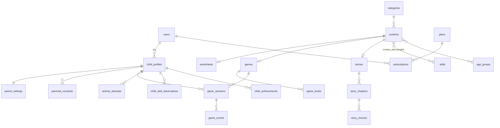

# معماری Backend (Laravel 13 · Modular Monolith)

## پشته
PHP 8.3 · Laravel 13 · PostgreSQL 16 · Redis (Cache/Queue) · Sanctum (توکن) · Filament 5 (پنل مدیریت)

## ماژول‌ها

هر ماژول در `backend/app/Modules/<Name>` مالک **جداول (Database/Migrations)، مسیرها (routes.php)، مدل‌ها، Policyها و منطق** خودش است و با یک `ModuleServiceProvider` در `bootstrap/providers.php` ثبت می‌شود. مسیرهای همه‌ی ماژول‌ها زیر `/api/v1` و با محدودیت نرخ `throttle:api` بارگذاری می‌شوند.

| ماژول | مسئولیت | جداول |
|---|---|---|
| **Shared** | پایه‌ی ماژول، صفحه‌بندی، زبان، Feature Flag | – |
| **Identity** | ثبت‌نام/ورود والد، بازیابی رمز، نقش‌ها | `users` (توسعه)، `roles`، `role_user` |
| **Children** | پروفایل حداقلی کودک، تنظیمات والد، رضایت‌نامه، توکن جلسه‌ی کودک، خروجی/حذف داده | `child_profiles`، `child_preferences`، `parent_settings`، `parental_consents` |
| **Catalog** | دنیاها/دسته‌ها، موضوع، مهارت، گروه سنی، محتوای پایه، ترجمه، رسانه، نسخه‌بندی | `categories`، `subjects`، `skills`، `age_groups`، `contents`، `content_translations`، `age_group_content`، `content_skill`، `media_assets`، `content_media`، `content_versions` |
| **Worksheets** | کاربرگ (Template + Params)، دانلود | `worksheets`، `worksheet_downloads` |
| **Games** | بازی، مراحل، جلسه، رویدادها، امتیازدهی سمت سرور | `games`، `game_levels`، `game_sessions` (ULID)، `game_events` |
| **Stories** | قصه، فصل، انتخاب مسیر | `stories`، `story_chapters`، `story_choices` |
| **Progress** | لاگ فعالیت، پیشرفت، امتیاز، مدال، مشاهده‌ی مهارت | `activity_attempts`، `child_progress`، `points_transactions`، `achievements`، `child_achievements`، `child_skill_observations` |
| **Recommendations** | موتور پیشنهاد Rule-Based (قابل توضیح) | – |
| **Subscriptions** | پلن، اشتراک، پرداخت، Entitlements، قرارداد درگاه | `plans`، `subscriptions`، `payments` |
| **Parent** | داشبورد تجمیعی، گزارش در صف | `reports` |

### قواعد ارتباط بین ماژول‌ها
- **رابطه‌های پویا:** `Catalog\Content` هیچ وابستگی به ماژول‌های جزئیات ندارد؛ هر ماژول رابطه‌ی خودش را ثبت می‌کند (`Content::resolveRelationUsing('game', …)`).
- **رویداد دامنه:** پایان بازی `Games\Events\GameSessionCompleted` را منتشر می‌کند؛ `Progress\Listeners\RecordGameProgress` امتیاز، پیشرفت، مهارت و مدال را ثبت و جوایز را در خود رویداد برمی‌گرداند.
- **قرارداد داده‌ی کودک:** هر ماژولی که داده‌ی کودک نگه می‌دارد یک `ChildDataSection` با tag `child-data-sections` ثبت می‌کند تا خروجی کامل داده برای والد همیشه کامل باشد.
- **دسترسی تجاری:** ماژول‌ها فقط از `Subscriptions\Support\Entitlements` می‌پرسند (`maxChildren()`، `canAccessPremium()`)؛ محدودیت‌ها در ستون `limits` پلن و قابل تغییر از CMS هستند.

## احراز هویت و دسترسی

| توکن | Ability | صادرکننده | دسترسی |
|---|---|---|---|
| والد | `parent` | `POST /auth/login` (۳۰ روز) | همه‌ی فرزندان خودش، تنظیمات، داشبورد، اشتراک |
| جلسه‌ی کودک | `child`، `child:{id}` | `POST /children/{id}/session` (۱۲ ساعت) | فقط داده‌ی همان کودک: شروع/پایان بازی، ثبت فعالیت، پیشرفت، پیشنهاد. **بدون** دسترسی به تنظیمات، فهرست فرزندان یا داشبورد والد |
| پنل مدیریت | نشست وب | `/admin/login` | فقط نقش‌های `admin` و `editor` |

- `Children\Support\ChildAccess` قاعده‌ی مالکیت + محدوده‌ی توکن کودک را یک‌جا اعمال می‌کند.
- Frontend توکن‌ها را در **کوکی httpOnly** نگه می‌دارد (الگوی BFF در `apps/web/app/api`)؛ جاوااسکریپت مرورگر هرگز به توکن دسترسی ندارد.
- محدودیت نرخ: `api` ‏۱۲۰/دقیقه، `auth` ‏۱۰/دقیقه، `game-events` ‏۲۴۰/دقیقه.

## مرجع API v1

| روش | مسیر | دسترسی | توضیح |
|---|---|---|---|
| POST | `/auth/register` · `/auth/login` | عمومی | ثبت‌نام (پذیرش قوانین الزامی) / ورود |
| POST | `/auth/forgot-password` · `/auth/reset-password` | عمومی | بازیابی رمز (پاسخ یکسان برای جلوگیری از افشای ایمیل) |
| GET/POST | `/auth/me` · `/auth/logout` | والد | |
| GET | `/categories` · `/categories/{slug}` · `/categories/{slug}/contents` | عمومی | درخت دنیاها (کش ۱۰ دقیقه) |
| GET | `/age-groups` · `/skills` | عمومی | |
| GET | `/worksheets?q&age&difficulty&access&template&perPage` | عمومی | |
| GET | `/worksheets/{slug}` · `/worksheets/{slug}/preview` | عمومی | |
| POST | `/worksheets/{slug}/download` | عمومی / ویژه: اشتراک | ثبت دانلود، Signed URL فایل |
| GET | `/games` · `/games/{slug}` · `/games/{slug}/levels` | عمومی | |
| POST | `/games/{slug}/sessions` | والد یا کودک | `{childId, level}` |
| POST | `/games/sessions/{id}/events` | والد یا کودک | تا ۲۰۰ رویداد در هر درخواست |
| POST | `/games/sessions/{id}/complete` | والد یا کودک | `{correct, mistakes, durationSeconds}` → ستاره‌ی محاسبه‌شده در سرور + جوایز |
| GET | `/stories` · `/stories/{slug}` · `/stories/{slug}/chapters` | عمومی | |
| CRUD | `/children` · `/children/{id}` | والد | ساخت با `consent: true`؛ حذف = زمان‌بندی حذف دائمی |
| GET/PUT | `/children/{id}/settings` | خواندن: والد/کودک · نوشتن: والد | |
| POST | `/children/{id}/session` | والد | توکن جلسه‌ی کودک |
| GET | `/children/{id}/export` | والد | خروجی کامل JSON داده‌ها |
| GET | `/children/{id}/progress` · `/achievements` · `/activity-history` · `/skills` | والد یا کودک | |
| POST | `/children/{id}/activities` | والد یا کودک | پایان قصه، نقاشی، کاربرگ، درس |
| GET | `/children/{id}/recommendations?limit&types[]` | والد یا کودک | |
| GET | `/parent/dashboard?childId` | والد | همه‌ی داده‌ی داشبورد در یک درخواست |
| GET/POST | `/parent/reports` · `/parent/reports/generate` · `/parent/reports/{id}/download` | والد | ساخت در صف |
| GET | `/plans` | عمومی (feature: subscriptions) | |
| GET/POST | `/subscriptions/current` · `/subscriptions/checkout` | والد | |
| GET/POST | `/payments/callback` | درگاه | تأیید سمت سرور، فعال‌سازی اشتراک |

**قالب پاسخ‌ها:** منبع تکی `{ data: … }` · فهرست `{ data: […], meta: { page, perPage, total, lastPage } }` · خطای اعتبارسنجی `422 { message, errors }`. نام فیلدها camelCase و هم‌خوان با `packages/types`.
**زبان:** `?locale=en` یا هدر `X-Locale` (پیش‌فرض fa؛ `Accept-Language` مرورگر عمداً نادیده گرفته می‌شود).

## گردش کار محتوا (CMS)
`draft → review → (scheduled) → published → archived`
- «تأیید و انتشار» فقط برای `admin`/`editor`؛ بازبین و زمان ثبت می‌شود و یک **نسخه‌ی کامل** (`content_versions`) ذخیره می‌شود.
- محتوای `ai_generated` بدون `reviewed_at` در سطح مدل قابل انتشار نیست.
- `content:publish-scheduled` هر دقیقه محتوای زمان‌بندی‌شده را منتشر می‌کند.

## حریم خصوصی کودک
- فقط نام نمایشی، سال/ماه تولد، آواتار و نتایج فعالیت ذخیره می‌شود.
- رضایت والد با نسخه‌ی سیاست، زمان و IP ثبت می‌شود.
- حذف: پروفایل فوراً از دسترس خارج و پس از ۳۰ روز با `children:purge` (روزانه) به‌طور کامل حذف می‌شود؛ همه‌ی جداول وابسته cascade می‌شوند.
- پنل مدیریت فقط نمای حداقلی و فقط‌خواندنی از پروفایل کودکان دارد.

## کارهای زمان‌بندی‌شده و صف
| فرمان / Job | زمان |
|---|---|
| `content:publish-scheduled` | هر دقیقه |
| `children:purge` | روزانه ۰۳:۱۵ |
| `sanctum:prune-expired --hours=24` | روزانه |
| `Parent\Jobs\GenerateChildReport` | صف Redis (۳ تلاش) |

## تست
۲۸ تست Feature روی PostgreSQL واقعی (`kidsworld_test`): احراز هویت، مالکیت و محدوده‌ی توکن کودک، محدودیت پلن، حذف و خروجی داده، فیلترها و قرارداد API، دسترسی محتوای ویژه، ترجمه، گردش کار انتشار و AI، چرخه‌ی کامل بازی و جوایز، داشبورد، پیشنهاد، گزارش در صف، پرداخت و Feature Flag.

## گام‌های بعدی
1. درگاه پرداخت واقعی (پیاده‌سازی `PaymentGateway`).
2. تبدیل گزارش HTML به PDF (Gotenberg/Chromium) در همان Job.
3. Laravel Scout + Meilisearch برای جستجو (سرویس در docker-compose آماده است).
4. آپلود آثار نقاشی کودک به Object Storage با Signed URL.
5. ماژول‌های Learning (درس‌ها)، Schools/Teachers و AI طبق نقشه‌ی راه.
