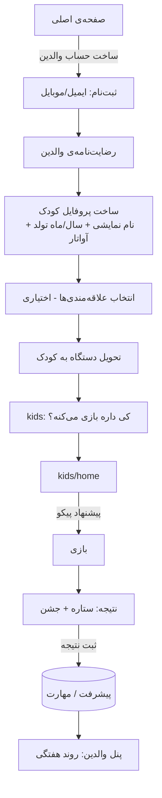
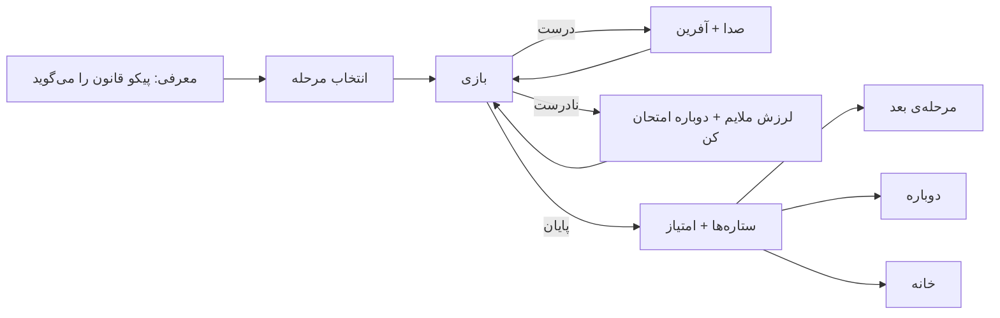

# ۳. جریان‌های کاربری (User Flows)

## ۳.۱ اولین ورود والد → اولین ستاره‌ی کودک

## ۳.۲ جلسه‌ی بازی کودک

## ۳.۳ والد: دانلود کاربرگ (بدون ثبت‌نام)

1. جستجو یا انتخاب سن در صفحه‌ی اصلی → `/worksheets?age=5`
2. فیلتر نوع فعالیت → انتخاب کارت
3. پیش‌نمایش A4 → «چاپ مستقیم» یا «دانلود PNG/SVG»
4. کاربرگ ویژه → پیش‌نمایش رایگان + دعوت به اشتراک (بدون دیوار پرداخت ناگهانی)

## ۳.۴ خروج کودک از محیط کودک

قفل کوچک کم‌رنگ در نوار بالا → **دروازه‌ی والدین** (سؤال ضرب نوشتاری) → `/parent`.
آواتار در نوار بالا → بازگشت به «کی داره بازی می‌کنه؟» (بدون دروازه، چون داخل محیط کودک می‌ماند).

## ۳.۵ حذف اطلاعات کودک

`/parent/settings` → «حذف کامل اطلاعات» → تأیید دومرحله‌ای با توضیح پیامد → Job حذف در صف (حداکثر ۳۰ روز شامل پشتیبان‌ها) → ایمیل تأیید.
